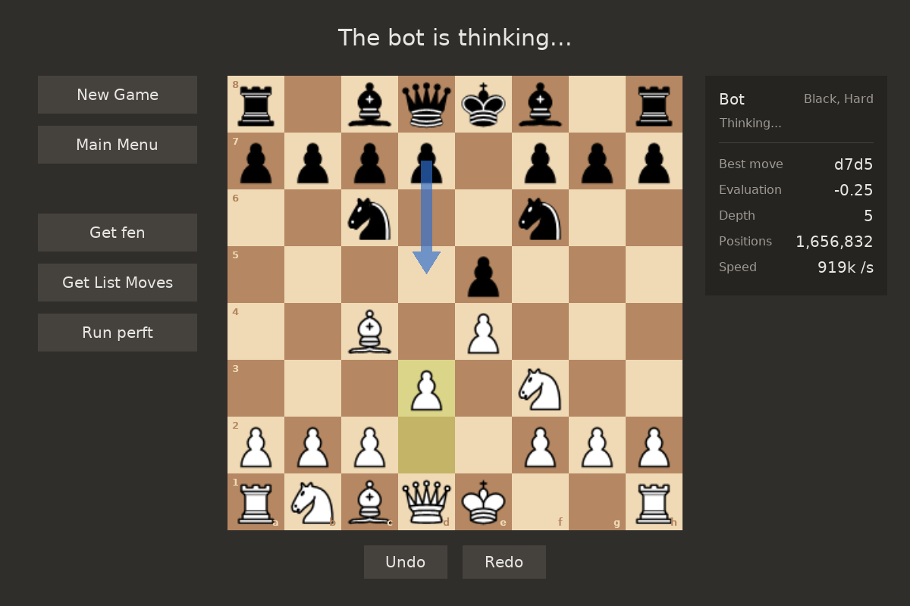
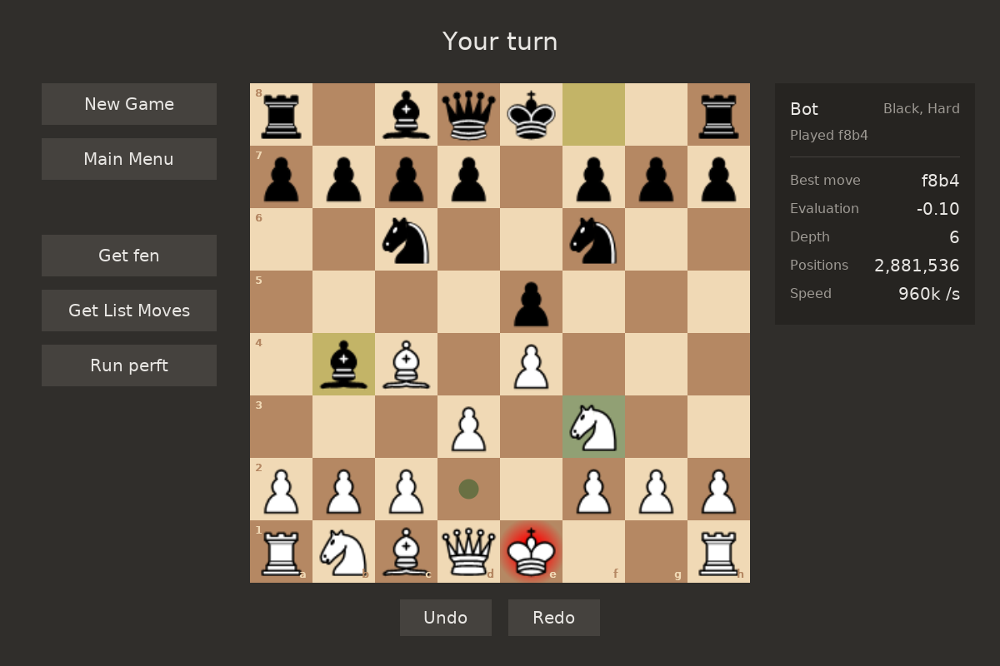

# ChessEngine

[](https://github.com/Doubasz/ChessEngine/actions/workflows/ci.yml)


A chess engine written from scratch in C++17, with an SDL2 desktop app to play against it or
against a friend. The engine has its own move generator, verified against the standard perft
positions, and an alpha-beta search that shows what it is thinking while it plays.

| Playing against the bot | Hints and check |
|:---:|:---:|
|  |  |


## Features

**Rules and move generation** (`src/core`)
- Complete rules: castling, en passant, promotions, check, checkmate, stalemate, fifty-move rule
- 0x88 board, legal move generation with make/unmake, FEN import and export, UCI move notation
- About 12 million positions per second in perft (depth 6 from the start position in under 10 seconds)

**Search** (`src/search`)
- Negamax alpha-beta with iterative deepening, under a depth limit, a time limit or both
- Quiescence search on captures and a check extension, so exchanges and checks are not cut off halfway
- Move ordering by MVV-LVA (most valuable victim, least valuable attacker) and killer moves
- Evaluation by material and piece-square tables, with a separate king table for the endgame
- Mate scores counted in moves, so it plays the fastest mate and delays its own

**Desktop app** (`src/gui`)
- Play against the bot (easy, medium, hard) with either color, or against a friend on the same computer
- Live view of the bot's search: best move so far as an arrow on the board, evaluation, depth,
  positions searched and speed
- Click or drag-and-drop to move, legal move hints, last move and check highlights, promotion picker
- Undo and redo, board flipped when playing black
- The bot thinks on its own thread, so the window stays responsive while it searches


## Getting started

### Prerequisites

- A C++17 compiler: GCC 9+, Clang 10+ or MSVC 2019+
- CMake 3.20+ and Ninja
- For the desktop app only: SDL2, SDL2_image 2.6+ and SDL2_ttf 2.20+ (versions that ship CMake config files)

The engine, the command line tools and the tests need nothing else. GoogleTest is downloaded by
CMake at configure time.

<details>
<summary><b>Windows (MSYS2)</b></summary>

From an MSYS2 MinGW64 shell:

```sh
pacman -S mingw-w64-x86_64-gcc mingw-w64-x86_64-cmake mingw-w64-x86_64-ninja \
          mingw-w64-x86_64-SDL2 mingw-w64-x86_64-SDL2_image mingw-w64-x86_64-SDL2_ttf
```

Then add `C:\msys64\mingw64\bin` to your `PATH` to build from PowerShell.
</details>

<details>
<summary><b>Ubuntu / Debian</b></summary>

```sh
sudo apt install build-essential cmake ninja-build libsdl2-dev libsdl2-image-dev libsdl2-ttf-dev
```

Ubuntu 24.04 or newer is needed for SDL2_image and SDL2_ttf versions with CMake support.
On older systems, build without the app: `-DCHESS_BUILD_GUI=OFF`.
</details>

<details>
<summary><b>macOS (Homebrew)</b></summary>

```sh
brew install cmake ninja sdl2 sdl2_image sdl2_ttf
```
</details>

### Build

```sh
git clone https://github.com/Doubasz/ChessEngine.git
cd ChessEngine
cmake --preset release
cmake --build --preset release
```

| Preset    | Build type | What it builds |
|-----------|------------|----------------|
| `release` | Release    | Everything, optimized. Use it to play. |
| `debug`   | Debug      | Everything, with debug info |
| `asan`    | Debug      | Engine and tests with AddressSanitizer and UBSan (Linux and macOS) |
| `ci`      | Release    | Engine and tests only, no SDL needed. Used by CI. |

Each preset builds into `build/<preset>/`.

### Run

```sh
cd build/release
./chess                 # the desktop app (chess.exe on Windows)
```

The app loads its images and font from the `sprites/` folder, which the build copies next to the executable.

| Control | Action |
|---|---|
| Click, or drag and drop | Select and move a piece |
| `←` / `→` | Undo / redo (against the bot, your move and its reply together) |
| `Esc` | Back to the menu |


## Command line tools

**`bestmove`** searches a position and prints the progress of each depth, then the best move:

```console
$ ./bestmove --time 3000
depth 1  score +0.50  nodes 20  time 0 ms  nps 0  best b1c3
...
depth 6  score +0.00  nodes 117221  time 111 ms  nps 1056045  best b1c3
depth 7  score +0.35  nodes 981770  time 763 ms  nps 1286723  best e2e4
bestmove e2e4

$ ./bestmove --depth 5 "r1bqkb1r/pppp1ppp/2n2n2/4p2Q/2B1P3/8/PPPP1PPP/RNB1K1NR w KQkq - 4 4"
depth 1  score mate 1  nodes 55  time 0 ms  nps 0  best h5f7
bestmove h5f7
```

Options: `--depth N` (plies), `--time MS`, and a FEN (the start position if omitted).
Without a limit it searches for 5 seconds.

**`perft`** counts the leaf nodes of the move tree to a given depth, split by root move in the same format
as Stockfish's `go perft`:

```console
$ ./perft 5
b1c3: 234656
b1a3: 198572
...
Nodes searched: 4865609
```

`tools/perftDiff.py` compares that output with Stockfish move by move, to pinpoint a move generation bug.


## Testing

```sh
ctest --preset release
```

- **Unit tests** (GoogleTest, `tests/core`, `tests/search`): FEN parsing, attacks, move generation
  edge cases (pins, checks, castling rules, en passant), make/unmake, game status, evaluation symmetry,
  mates found, tactics, and the depth, time and stop limits of the search.
- **Perft regression tests**: node counts of the [six standard positions](https://www.chessprogramming.org/Perft_Results)
  at depth 4 or 5. Any move generation bug changes these numbers.

Every pull request is built and tested by GitHub Actions with GCC and Clang on Linux and MSVC on Windows.


## Project structure

```
src/
├── core/         Board, moves, move generation, FEN, perft. No dependencies.
├── search/       Evaluation and alpha-beta search, built on core
├── gui/          SDL2 app: screens, drawing, bot thread
├── bestmove/     Command line search tool
└── perft/        Command line perft tool
tests/
├── core/         Unit tests of the rules
├── search/       Unit tests of the evaluation and search
└── CMakeLists.txt  GoogleTest setup and perft regression tests
sprites/          Piece images and font used by the app
tools/            Perft comparison script
```

The layers only depend downward: `gui` → `search` → `core`. Everything outside `core` uses the
public `chess::Board` interface only, so the board representation can change without touching
the search or the app.


## How it works

**Board.** Squares are numbered in the 0x88 layout: `index = rank * 16 + file`, a 128-square array
where only half the squares are on the board. Moving off the board always sets bit `0x08` or `0x80`,
so one test, `(square & 0x88) != 0`, catches every move that leaves the board.

**Move generation.** Moves are generated for each piece, then each one is played, checked for
leaving the king attacked, and taken back. Only legal moves are returned. Moves are 4 bytes and
stored in a fixed size list, so generating moves never allocates memory.

**Search.** The bot searches depth 1, then 2, then 3, and so on, until it hits its limit. Each pass
starts with the best move of the previous one, which makes alpha-beta skip most of the tree. At the
end of each line it keeps playing captures until the position is quiet before evaluating it, so it
never judges a position in the middle of an exchange. If the time runs out in the middle of a depth,
that depth is dropped and the best move of the last complete one is played.

| Difficulty | Limit | Typical depth |
|------------|-------|---------------|
| Easy       | 2 plies | 2 |
| Medium     | 4 plies | 4 |
| Hard       | 3 seconds per move | 6 to 7 in the middlegame |


## Roadmap

- [ ] Draw by threefold repetition and insufficient material
- [ ] Zobrist hashing and a transposition table
- [ ] UCI protocol, to play in GUIs like Arena or Cute Chess and against other engines
- [ ] Move list in standard algebraic notation (SAN) in the app
- [ ] Better evaluation: pawn structure, mobility, king safety
- [ ] Bitboard board representation


## Contributing

Work happens on short-lived branches off `main` (`feat/...`, `fix/...`, `refactor/...`), merged through
pull requests once CI passes. Commit messages follow [Conventional Commits](https://www.conventionalcommits.org/):
`feat(search): add quiescence search`, `fix(core): ...`, `test: ...`.


## Credits

- Piece-square tables from Tomasz Michniewski's
  [Simplified Evaluation Function](https://www.chessprogramming.org/Simplified_Evaluation_Function)
- Perft positions and node counts from the [Chess Programming Wiki](https://www.chessprogramming.org/Perft_Results)
- [DejaVu Sans](https://dejavu-fonts.github.io/) font, see `sprites/fonts/LICENSE`
